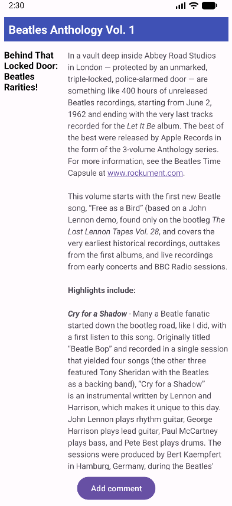
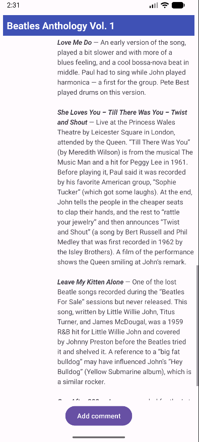
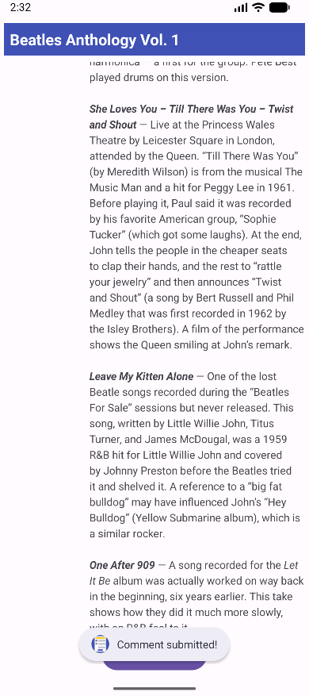

# Naloga 4 – ScrollingText

Šolska naloga pri predmetu **Razvoj mobilnih aplikacij (Naloga 4)**.
Android aplikacija v jeziku **Java**, ki prikazuje daljše besedilo članka v drsnem pogledu z dvema stolpcema.

## Opis

Aplikacija prikazuje članek **Beatles Anthology Vol. 1**:

- naslov na vrhu zaslona (ostane viden med drsenjem)
- `ScrollView` z natanko enim notranjim elementom, vodoravnim `LinearLayout`
- levi stolpec (100dp) s podnaslovom in desni, širši stolpec z besedilom članka (`TextView`)
- gumb **Add comment** na sredini spodaj, ki ob kliku s `Toast` prikaže sporočilo *Comment submitted!*

Vsa besedila (naslov, podnaslov, članek, gumb) so shranjena v `strings.xml`. Besedilo uporablja osnovno oblikovanje (krepko, poševno) in samodejno povezavo do spletnega naslova.

## Zaslonske slike

**Začetni prikaz**

**Drsenje besedila**

**Toast ob kliku na gumb Add comment**

## Struktura projekta

| Datoteka | Opis |
|---|---|
| `app/src/main/java/.../MainActivity.java` | obdelava klika na gumb (Toast) |
| `app/src/main/res/layout/activity_main.xml` | postavitev (ScrollView, LinearLayout, TextView, Button) |
| `app/src/main/res/values/strings.xml` | besedilni viri |

## Namestitev na telefon

Datoteka `app-debug.apk` je na voljo v razdelku **Releases** tega repozitorija.

1. Prenesi `app-debug.apk` na telefon.
2. Odpri datoteko in dovoli namestitev iz neznanih virov.
3. Tapni **Install** in nato **Open**.

## Avtor

Nejc Bajda – ŠC Nova Gorica, Elektrotehniška in računalniška šola
